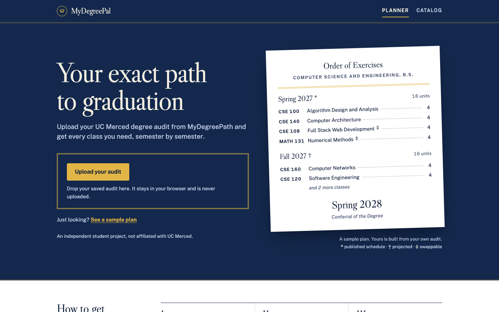
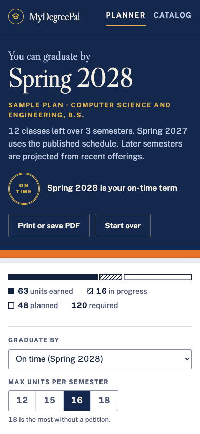
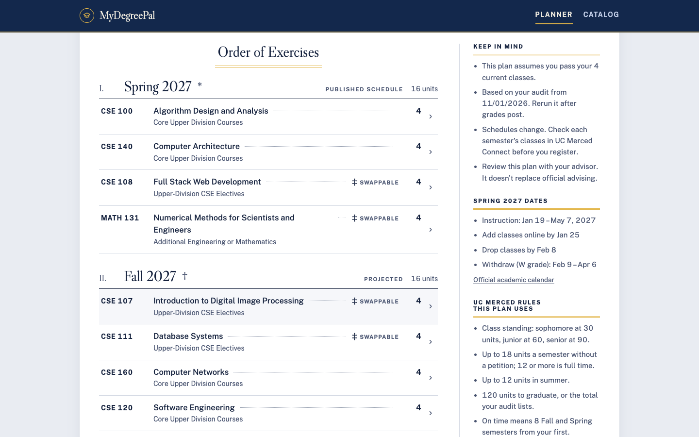
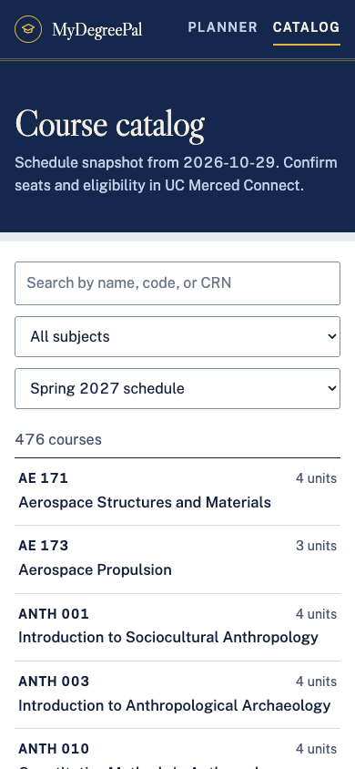

# MyDegreePal

**Your exact path to graduation at UC Merced.** Upload your MyDegreePath degree audit and get every class you need,
semester by semester, through graduation. The audit is read in your browser and never uploaded.

- Live (original): https://mydegreepal.vercel.app
- Redesign preview: https://mydegreepal-redesign.vercel.app

MyDegreePal is an independent student project by Dawood Khan. It is not affiliated with UC Merced and doesn't replace
official advising.



| Your plan | The Order of Exercises | Course catalog |
|---|---|---|
|  |  |  |

## How it works

1. In Chrome on a computer, open [MyDegreePath](https://ucmerced.uachieve.com/selfservice/), run your audit (or a
   What-If audit if you're undeclared) and save the page as **Webpage, HTML Only**.
2. Drop the file on the planner. `js/audit.js` parses it in the browser: requirements, completed and in-progress
   classes, grades and units.
3. `js/planner.js` matches the open requirements against `data/courses.json` (prerequisites, class-standing limits,
   when each class is usually offered, Spring 2027 CRNs) and builds a plan semester by semester.
4. You can change the target term, the units per semester (12–18) and summer classes, and swap electives. You can also
   print the plan or save it as a PDF for your advisor.

The plan stays in `sessionStorage` while the tab is open. There are no accounts, cookies or analytics.

## UC Merced rules the planner uses

All of these were checked against official UC Merced sources on 2026-11-03. The notes and text snapshots are in
[`docs/uc-merced-policies/`](docs/uc-merced-policies/README.md), and the line-by-line comparison with the code is in
[`CODE-CHECK.md`](docs/uc-merced-policies/CODE-CHECK.md).

| Rule | Value | Source |
|---|---|---|
| Class standing | Sophomore 30, Junior 60, Senior 90 units | General Catalog 2026–27 |
| Units per semester | Up to 18 without a petition; 12 is full time | Advising offices |
| Summer | Up to 12 units | Summer Session |
| Degree | 120 units minimum (or the audit's own total) | General Catalog 2026–27 |
| On time | 8 Fall/Spring semesters; going past 9 needs School approval | General Catalog, School advising |
| Prerequisites | C- or better; WRI 001 needs C or better | General Catalog 2026–27 |
| Spring 2027 dates | Registration Nov 2–13, 2026; add by Jan 25; drop by Feb 8 | Registrar |

**Update every term:** `FIRST_TERM` in `js/planner.js`, the registration notice in `index.html`, the "Spring 2027
dates" panel in `js/app.js`, and `data/courses.json` (schedule snapshot, currently 2026-10-29).

## Project layout

```
index.html          planner (landing + plan)
catalog.html        course catalog search
privacy.html        privacy notice
css/style.css       all styles (design tokens in :root)
js/audit.js         degree-audit parser (runs in the browser and in Node)
js/planner.js       plan builder
js/app.js           planner page UI
js/catalog.js       catalog page UI
data/courses.json   course data and schedule snapshot
samples/            the sample audit behind "See a sample plan"
fonts/              self-hosted Libre Caslon Display and Public Sans (SIL OFL 1.1, see fonts/OFL.txt)
tests/              Node regression tests
docs/               UC Merced policy sources and README screenshots (not deployed)
DESIGN.md           the design system ("commencement program")
PRODUCT.md          product brief
vercel.json         security headers (strict CSP)
```

## Run it locally

There is no build step. Serve the folder over HTTP, because the pages `fetch()` the course data:

```sh
python3 -m http.server 8000
# open http://localhost:8000
```

## Tests

```sh
node --test tests/
```

The tests pin the sample plan and guard the parser: audits saved without closing `</td>`/`</tr>` tags, and text hidden
in `<textarea>`/`<template>`. They also check catalog code padding and the class-standing thresholds. GitHub Actions
runs them on every push and pull request (`.github/workflows/test.yml`).

## Deploy

The Vercel project `mydegreepal-redesign` is connected to this repo, so every push to `main` deploys. Pull requests get
preview URLs. `.vercelignore` keeps `docs/`, `tests/` and the Markdown files off the site.

`vercel.json` sends a strict Content-Security-Policy (no inline scripts or styles), so:

- don't add `style="…"` attributes or inline `<script>` blocks; set dynamic sizes from JS with `element.style`, as
  `render()` in `js/app.js` does;
- keep fonts and assets self-hosted.

Only the `mydegreepal-redesign*.vercel.app` hosts get an `X-Robots-Tag: noindex` header, so the same file is safe on the
original domain.

## Design

The redesign treats the plan as the printed program for your own commencement:
- a regalia-navy cover with gold rules;
- semesters as an "Order of Exercises" that ends with the conferral term;
- the discipline's academic hood color as a band under the cover;
- status shown as printed reference marks (`*` published schedule, `†` projected, `‡` swappable, `°` your pick).

Tokens, components, motion and print rules are in [DESIGN.md](DESIGN.md).

## Known limits

- Transfer students get the same 8-semester "on time" target. UC Merced publishes no official transfer timeline.
- Audit flag codes for duplicate or excluded classes (`D`, `X`) are assumed from uAchieve. The sample audit has none.
- The WRI 001 "C or better" rule hasn't been tested against a real audit yet.

## License

No license has been chosen yet. The code belongs to Dawood Khan, and he decides how it may be reused. The fonts are
under the SIL Open Font License 1.1.
